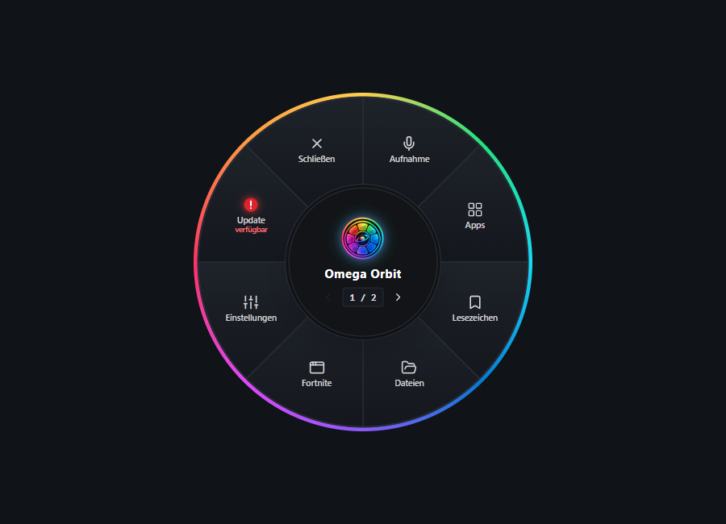
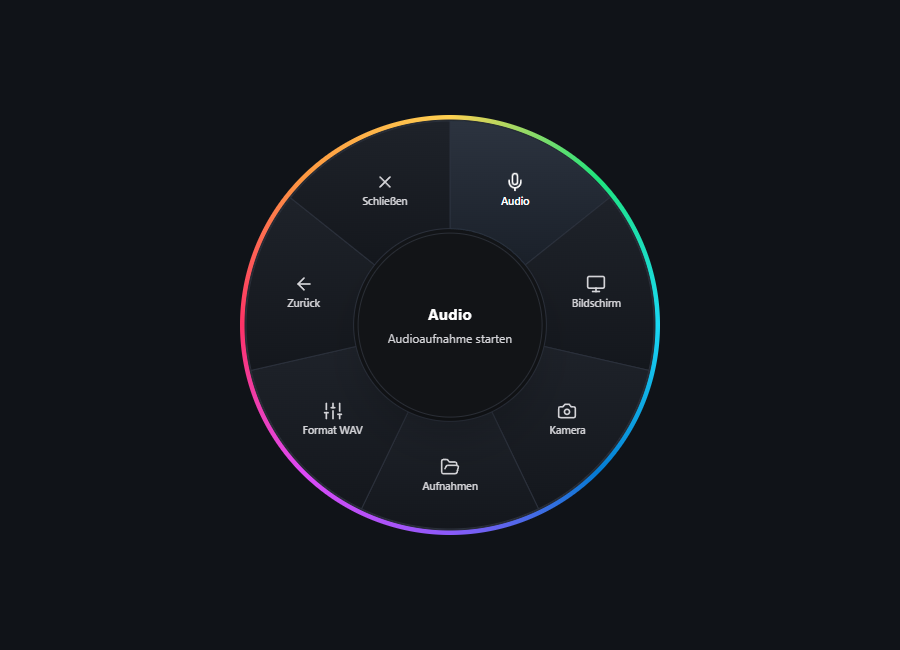
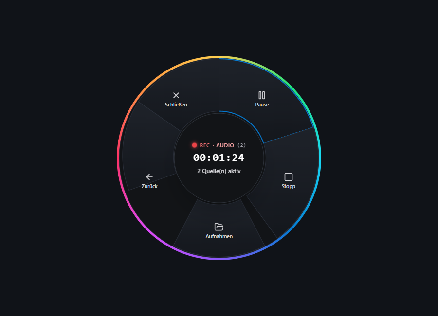
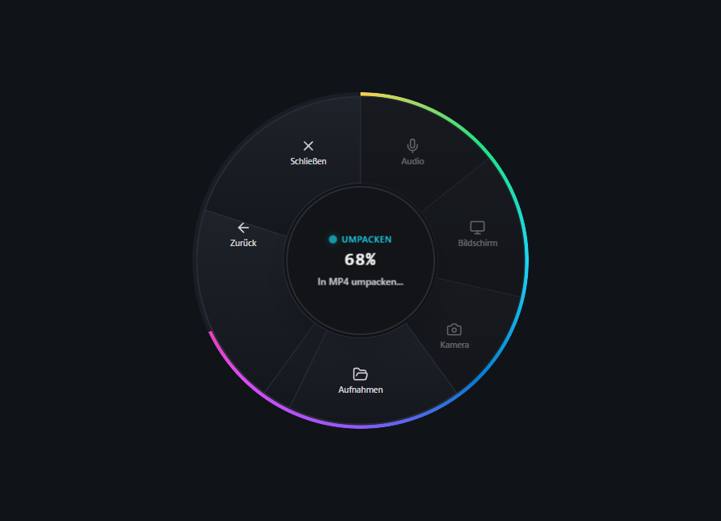
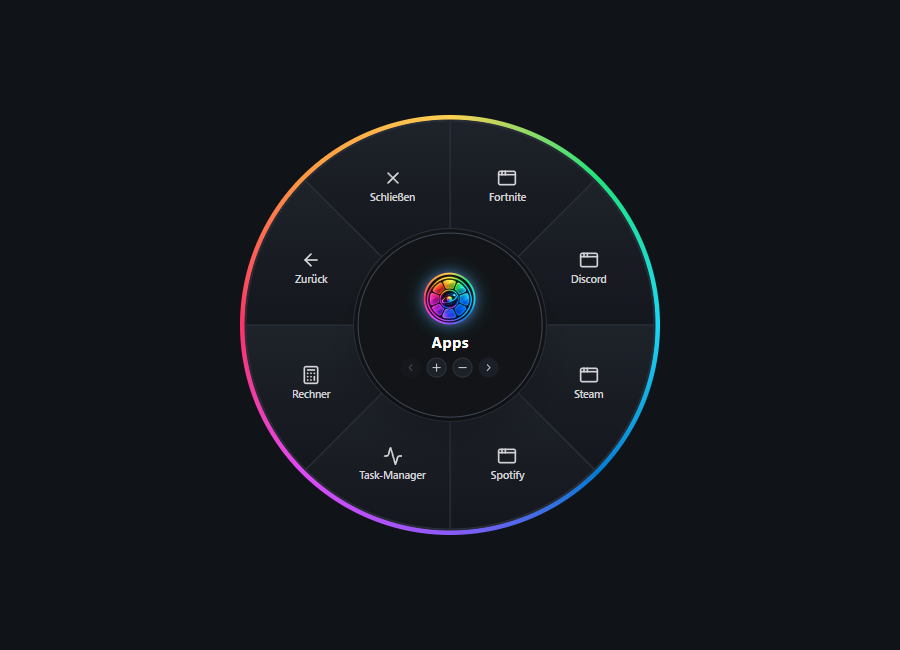
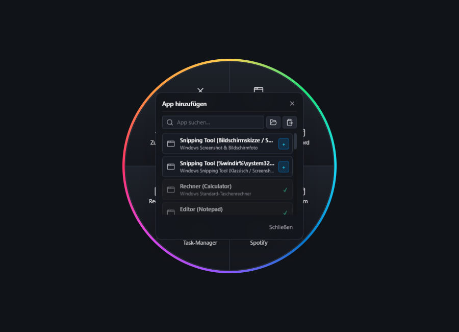
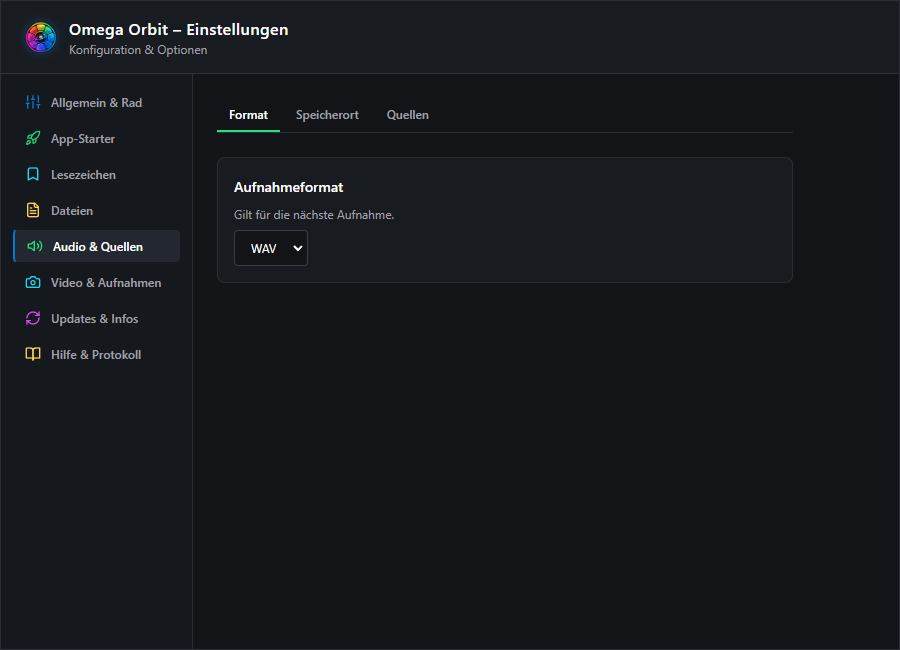
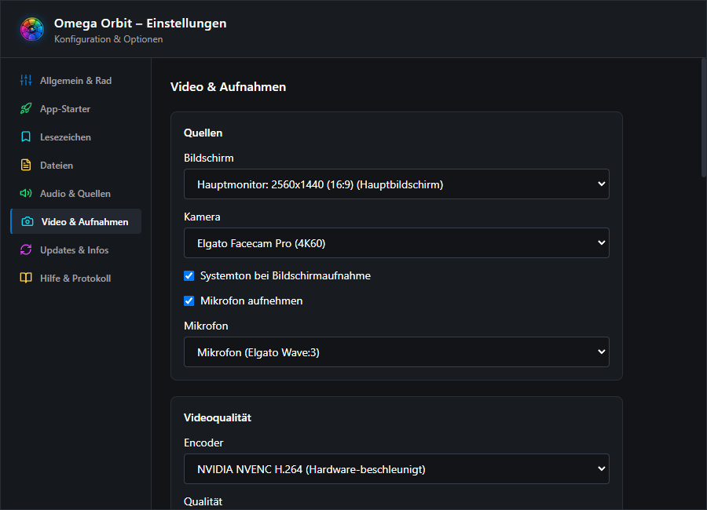

<h1 align="center">Omega Orbit</h1>

<strong><a href="https://orbit.omegaprojects.de">orbit.omegaprojects.de</a> – Ein Produkt von <a href="https://omegaprojects.de">omegaprojects.de</a></strong>

Deine Werkzeuge im Kreis · Your tools in orbit

  <a href="https://orbit.omegaprojects.de">Produktseite / Website</a> ·
  <a href="https://github.com/OmegaProjct/Omega-Orbit-Releases/releases/latest">Download v0.10.1</a> ·
  <a href="https://omegaprojects.de">omegaprojects.de</a> ·
  <a href="#deutsch">Deutsch</a> · <a href="#english">English</a> ·
  <a href="CHANGELOG.md">Changelog DE</a> · <a href="CHANGELOG.en.md">Changelog EN</a>

 

---

## ⚡ Download / Herunterladen

| System | Download & Produktseite | Status |
| --- | --- | --- |
| Windows x64 | [**Aktuelles Setup v0.10.1 herunterladen / Download latest setup**](https://github.com/OmegaProjct/Omega-Orbit-Releases/releases/latest) · [**orbit.omegaprojects.de**](https://orbit.omegaprojects.de) | Verfügbar / Available |
| macOS · Linux | — | Als zukünftiges Ziel geplant / Planned for the future |

Auf der Release-Seite die Windows-Setup-Datei auswählen oder über [**orbit.omegaprojects.de**](https://orbit.omegaprojects.de) starten. Bereits installierte Versionen können direkt über den eingebauten Updater aktualisiert werden.

On the release page, choose the Windows setup file or visit [**orbit.omegaprojects.de**](https://orbit.omegaprojects.de). Installed versions can be updated directly through the built-in updater.

---

## 📸 Einblicke / A closer look

| Orbit-Rad (Hauptmenü) · Orbit wheel | Aufnahme-Menü · Recording submenu |
| :---: | :---: |
|  |  |

| Aktive Aufnahme · Active recording | Regenbogen-Fortschritt · Rainbow progress |
| :---: | :---: |
|  |  |

| App-Starter · Quick app launcher | Smarter App-Katalog · App catalog |
| :---: | :---: |
|  |  |

| Audio-Einstellungen · Audio settings | Video-Einstellungen · Video settings |
| :---: | :---: |
|  |  |

*Produktansichten auf einheitlich dunklem Hintergrund (900 × 650 px) · Product views on a consistent dark background*

---

# 🇩🇪 Deutsch

**Omega Orbit** ([orbit.omegaprojects.de](https://orbit.omegaprojects.de) – ein Produkt von [omegaprojects.de](https://omegaprojects.de)) vereint deine wichtigsten Werkzeuge in einem eleganten Radial-Rad direkt an deinem Mauszeiger (`Strg + Leertaste`). Starte Programme und Spiele mit In-Rad-Ordnern, nimm Bildschirme, Webcam und Multi-Quellen-Audio synchron auf, höre und schneide Internetradio im Satelliten-Player mit und wandle Dateien direkt lokal im Rad oder im 54-Werkzeuge-Konverter um.

## 🌟 Highlights in Version 0.10.1

- **Radial-Schnellstarter mit Ordnern & Wackelmodus:** Öffne das Werkzeugrad per `Strg + Leertaste` direkt am Mauszeiger – mit 4, 6 oder 8 Kacheln, anpassbarer Rad-, Symbol- und Schriftgröße (70 % bis 180 %), 3-stufigem Startseiten-Layout und direkter Ordnerverwaltung per Drag-and-drop.
- **Spiele-Launcher, Apps, Lesezeichen & Dateien:** Findet automatisch installierte Windows- und Store-Programme sowie Spiele von Steam, Epic Games, GOG Galaxy, Ubisoft Connect und Xbox mit echten Symbolen.
- **Bildschirm-, Kamera- & Multi-Audio-Aufnahme:** Zeichne ganze Bildschirme mit bis zu 10 Audioquellen (Systemton, Mikrofon, Spiele, Browser) und flexibler Bild-in-Bild-Webcam (Kreis, abgerundetes Rechteck oder PNG-Maske) in 1080p 60 FPS über GPU-Encoder (NVIDIA NVENC, Intel QSV, AMD AMF) auf – inklusive verlustfreiem MP4-Remuxing auf dem Regenbogenrand.
- **Internetradio-Player & Radio-Aufnahme:** Durchsuche weltweite Radiosender, docke den kompakten Satelliten-Player mit Verbindungsbrücke ans Rad an (oder bewege ihn frei), spule im 3-Minuten-Timeshift-Puffer zurück, exportiere erkannte Songs verlustfrei oder schneide ganze Sendungen als Original, MP3, WAV oder FLAC auf einem eigenen Ausgabegerät mit.
- **Lokaler Medien-Konverter & 54-Werkzeuge-Bereich:** Wandle Video-, Audio- und Bilddateien komplett offline direkt im Rad um (inklusive ZIP/7z/RAR-Archivierung) oder nutze 54 Spezialwerkzeuge für Schnitt, Skalierung, Komprimierung, Wasserzeichen, PDF-/Office-Dokumente mit OCR (Deutsch & Englisch) und Archive.
- **Eingebauter Auto-Updater:** Prüft im Hintergrund auf neue Versionen, zeigt verständliche Versionshinweise, validiert Downloads per SHA-256-Prüfsumme und schützt laufende Aufnahmen sowie Konvertierungen.

## 🎯 Bedienung

| Aktion | Tastenkombination / Maus |
| --- | --- |
| Rad öffnen | `Strg + Leertaste` (in den Einstellungen anpassbar) oder Klick ins Windows-Tray |
| Kachel auswählen | Mit der Maus anklicken oder mit Pfeiltasten / `Tab` ansteuern und `Enter` drücken |
| Blättern | Mausrad über dem Rad drehen oder Pfeile in der Radmitte nutzen |
| Ordner & Bearbeiten | `+` legt Einträge oder Ordner an; `Bearbeiten` (oder Gedrückthalten) startet den Wackelmodus zum Sortieren |
| Zurück / Schließen | `Esc` oder Klick auf Zurück/Schließen; Verhalten beim Loslassen von `Strg` und Vordergrund-Verhalten einstellbar |
| Einstellungen & Beenden | Rechtsklick auf das Orbit-Symbol im Windows-Infobereich (Tray) |

## 📜 Versionsverlauf

Im [öffentlichen Changelog](CHANGELOG.md) stehen alle Neuerungen und Fehlerbehebungen verständlich zusammengefasst. Das technische Entwicklungstagebuch liegt im privaten Entwicklungsrepository.

---

# 🇬🇧 English

**Omega Orbit** ([orbit.omegaprojects.de](https://orbit.omegaprojects.de) – a product by [omegaprojects.de](https://omegaprojects.de)) combines your essential daily tools into a sleek circular wheel summoned instantly at your mouse cursor (`Ctrl + Space`). Launch apps and games organized in in-wheel folders, record screens, webcams, and multi-source audio in sync, listen to and record internet radio in a satellite player, and convert files offline right inside the wheel or the 54-tool converter workspace.

## 🌟 Highlights in Version 0.10.1

- **Radial Quick-Launcher with Folders & Wiggle Edit:** Summon the wheel via `Ctrl + Space` directly at your cursor – with 4, 6, or 8 tiles, customizable wheel, icon, and label sizes (70% to 180%), a 3-tier start-page layout, and drag-and-drop folder organization.
- **Game Launcher Discovery, Apps, Bookmarks & Files:** Automatically discovers Windows and Store apps alongside installed games from Steam, Epic Games, GOG Galaxy, Ubisoft Connect, and Xbox with authentic icons.
- **Screen, Webcam & Multi-Source Audio Recording:** Capture full displays with up to 10 audio sources (system sound, microphone, games, browser) and picture-in-picture webcam overlays (circle, rounded rectangle, or custom PNG mask) at crisp 1080p 60 FPS using GPU hardware encoders (NVIDIA NVENC, Intel QSV, AMD AMF) plus lossless MP4 remuxing along the rainbow rim.
- **Internet Radio Player & Recorder:** Search stations worldwide, dock the compact satellite player to the wheel with a glowing connection bridge (or move it freely), scrub through a 3-minute timeshift buffer, export recognized songs losslessly, or record full shows as Original stream, MP3, WAV, or FLAC on a dedicated audio output device.
- **Offline Media Converter & 54-Tool Workspace:** Convert video, audio, and image files locally right inside the wheel (with ZIP/7z/RAR archiving fallback) or open the 54-tool workspace for trimming, resizing, compressing, watermarking, PDF/Office tools with OCR (German & English), and archives.
- **Built-in Auto-Updater:** Checks for updates automatically, presents clear release notes, verifies SHA-256 checksums, and protects active recordings and conversions.

## 🎯 Controls

| Action | Shortcut / Mouse |
| --- | --- |
| Open the wheel | `Ctrl + Space` (customizable in settings) or click the tray icon |
| Select a tile | Click with mouse, or navigate with arrow keys / `Tab` and press `Enter` |
| Paging | Scroll mouse wheel over the launcher or click the center hub arrows |
| Folders & Edit | Use `+` to add items or folders; click `Edit` (or press and hold) for drag-and-drop wiggle mode |
| Back / Close | `Esc` or click Back / Close; release-key closing and always-on-top behavior are configurable |
| Settings & Quit | Right-click the Orbit icon in the Windows notification area (tray) |

## 📜 Changelog

The [public changelog](CHANGELOG.en.md) describes all improvements and fixes in plain language. The technical development journal stays in the private development repository.
