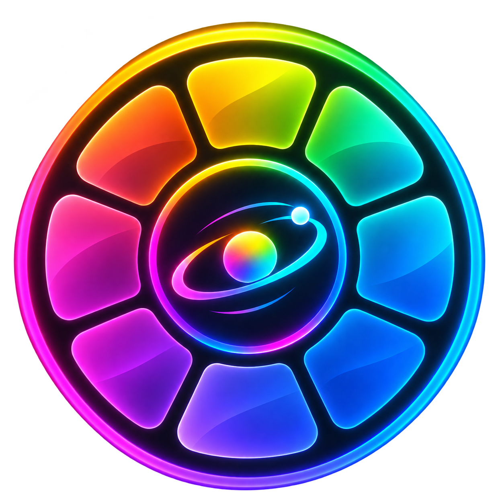
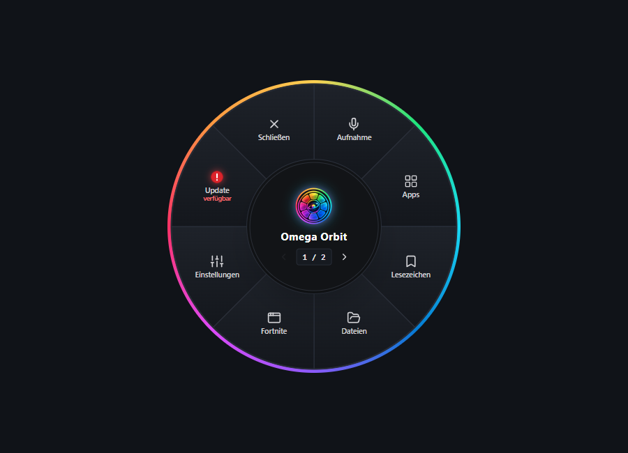
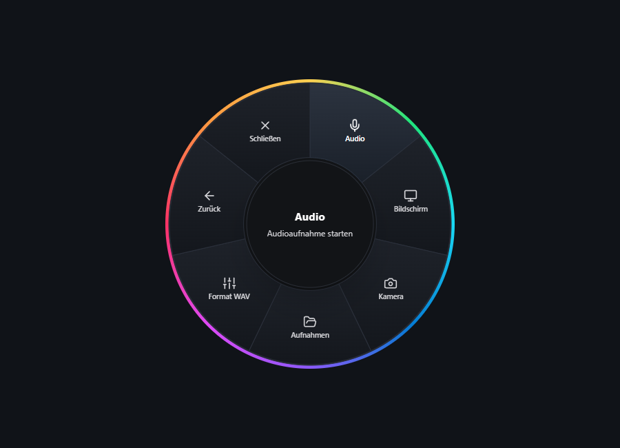
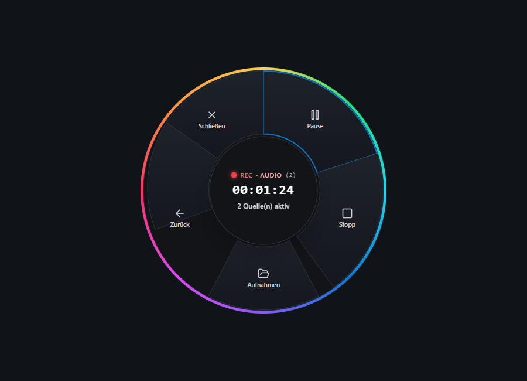
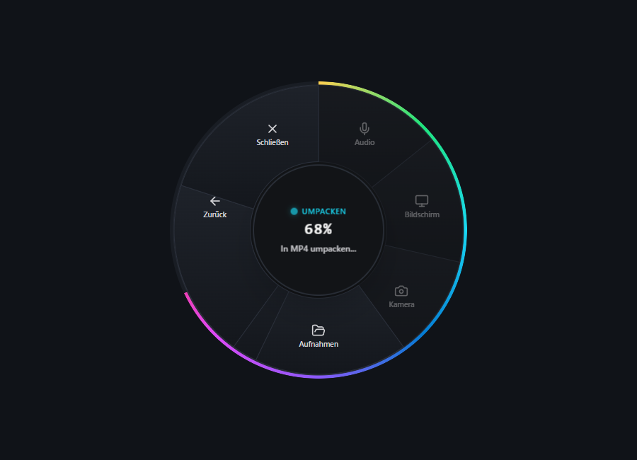
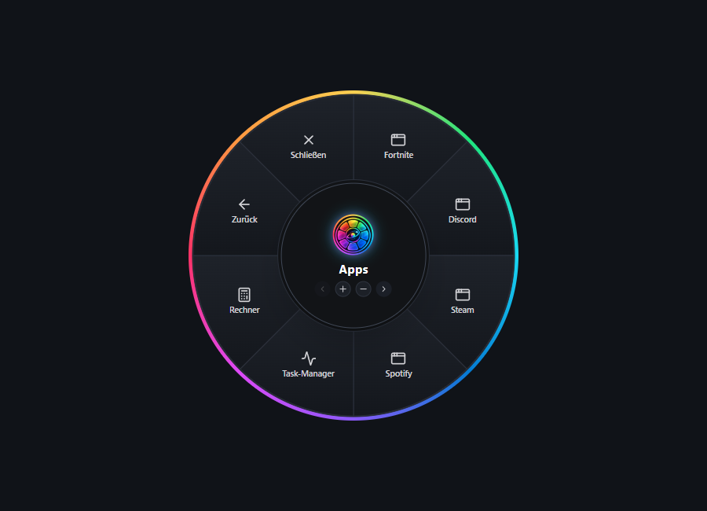
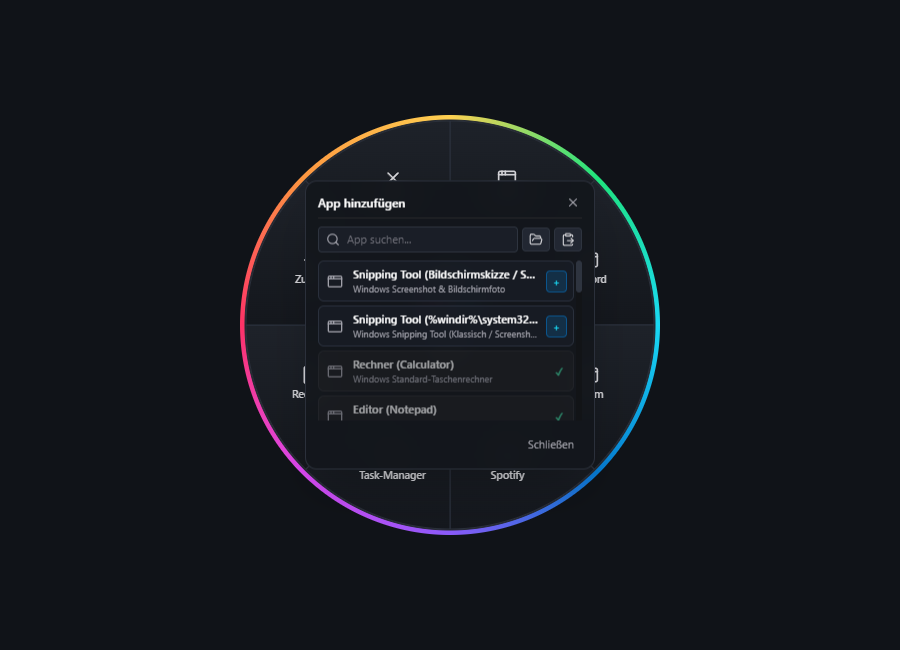
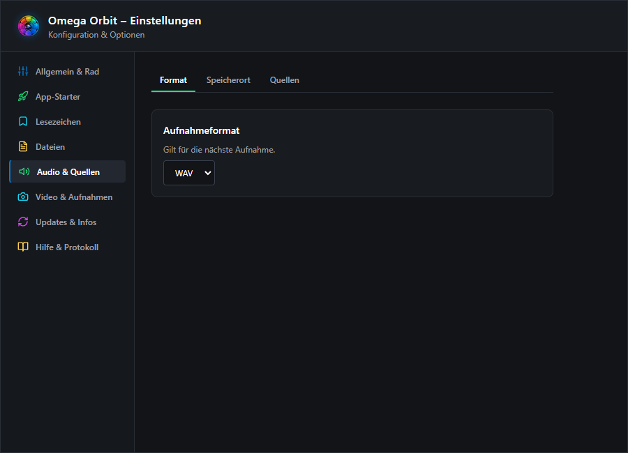
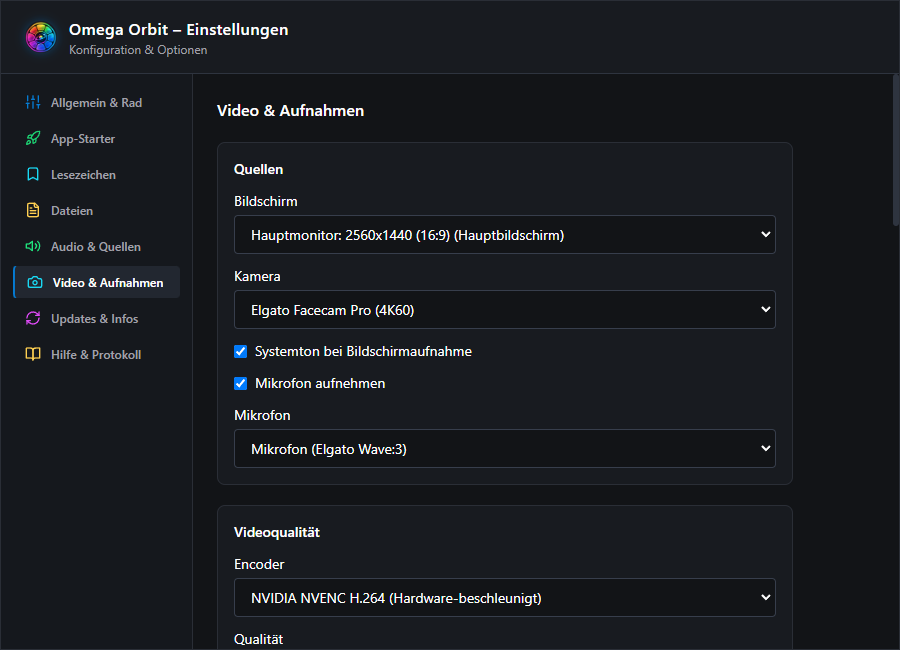

<h1 align="center">Omega Orbit</h1>

Deine Werkzeuge im Kreis · Your tools in orbit

  <a href="#deutsch">Deutsch</a> · <a href="#english">English</a> ·
  <a href="https://github.com/OmegaProjct/Omega-Orbit-Releases/releases/latest">Download</a> ·
  <a href="CHANGELOG.md">Changelog DE</a> · <a href="CHANGELOG.en.md">Changelog EN</a>

 

---

## ⚡ Download / Herunterladen

| System | Download | Status |
| --- | --- | --- |
| Windows x64 | [**Aktuelles Setup herunterladen / Download latest setup**](https://github.com/OmegaProjct/Omega-Orbit-Releases/releases/latest) | Verfügbar / Available |
| macOS · Linux | — | Als zukünftiges Ziel geplant / Planned for the future |

Auf der Release-Seite die Windows-Setup-Datei auswählen. Bereits installierte Versionen können über den eingebauten Updater aktualisiert werden.

On the release page, choose the Windows setup file. Installed versions can be updated through the built-in updater.

---

## 📸 Einblicke / A closer look

| Orbit-Rad (Hauptmenü) · Orbit wheel | Aufnahme-Menü · Recording submenu |
| :---: | :---: |
|  |  |

| Aktive Aufnahme · Active recording | Regenbogen-Fortschritt · Rainbow progress |
| :---: | :---: |
|  |  |

| App-Starter · Quick app launcher | Smarter App-Katalog · App catalog |
| :---: | :---: |
|  |  |

| Audio-Einstellungen · Audio settings | Video-Einstellungen · Video settings |
| :---: | :---: |
|  |  |

*Produktansichten auf einheitlich dunklem Hintergrund (900 × 650 px) · Product views on a consistent dark background*

---

# 🇩🇪 Deutsch

**Omega Orbit** bringt kleine Werkzeuge in ein Rad direkt an deinen Mauszeiger. Im Mittelpunkt steht derzeit die schnelle Audioaufnahme unter Windows.

## 🌟 Highlights

- **Schnell zur Hand:** Mit `Strg + Leertaste` das Orbit-Rad öffnen und Kacheln mit der Maus oder Tastatur auswählen.
- **Mehrere Audioquellen:** Bis zu zehn Geräte oder laufende Anwendungen auswählen und gemeinsam in einer Aufnahme speichern – etwa Mikrofon und Systemaudio.
- **WAV oder MP3:** Das Format in den Einstellungen oder direkt im Audio-Rad wählen. Beim Umwandeln zeigt der Rad-Rand den Fortschritt.
- **Aufnahmen finden:** Den Aufnahmeordner direkt aus dem Audio-Rad öffnen. Automatisches Speichern oder Speicherabfrage sind einstellbar.
- **Einfach aktuell bleiben:** Updates über die Update-Kachel suchen und herunterladen; die Installation startest du selbst.
- **Persönlich einstellen:** Radgröße, Sprache, Schließverhalten und Windows-Autostart anpassen. Hilfe und Ereignisprotokoll findest du in den Einstellungen.

## 🎯 Bedienung

| Aktion | Bedienung |
| --- | --- |
| Rad öffnen | `Strg + Leertaste` oder Klick auf das Symbol im Windows-Infobereich |
| Kachel auswählen | Mit der Maus anklicken oder mit Pfeiltasten/`Tab` auswählen und `Enter` drücken |
| Zurück oder schließen | `Esc`; das Verhalten beim Loslassen von `Strg` ist einstellbar |
| Einstellungen und Beenden | Rechtsklick auf das Symbol im Infobereich |

## 📜 Versionsverlauf

Im [öffentlichen Changelog](CHANGELOG.md) stehen Neuerungen und Fehlerbehebungen verständlich zusammengefasst. Das technische Entwicklungstagebuch liegt im privaten Entwicklungsrepository.

---

# 🇬🇧 English

**Omega Orbit** puts small tools in a wheel at your mouse pointer. Its current focus is quick audio recording on Windows.

## 🌟 Highlights

- **Ready when needed:** Open the Orbit wheel with `Ctrl + Space` and choose a tile with your mouse or keyboard.
- **Multiple audio sources:** Select up to ten devices or running applications and combine them in one recording, such as microphone and system audio.
- **WAV or MP3:** Choose the format in settings or directly from the audio wheel. The wheel's edge shows conversion progress.
- **Find your recordings:** Open the recordings folder directly from the audio wheel. Choose automatic saving or a save prompt.
- **Stay up to date:** Check for and download updates from the update tile; you start the installation yourself.
- **Make it yours:** Adjust wheel size, language, close behaviour and Windows startup. Help and the event log are available in settings.

## 🎯 Controls

| Action | Control |
| --- | --- |
| Open the wheel | `Ctrl + Space` or click the icon in the Windows notification area |
| Choose a tile | Click it, or use arrow keys/`Tab` and press `Enter` |
| Go back or close | `Esc`; the behaviour when releasing `Ctrl` is configurable |
| Settings and quit | Right-click the notification area icon |

## 📜 Changelog

The [public changelog](CHANGELOG.en.md) describes improvements and fixes in plain language. The technical development journal stays in the private development repository.
