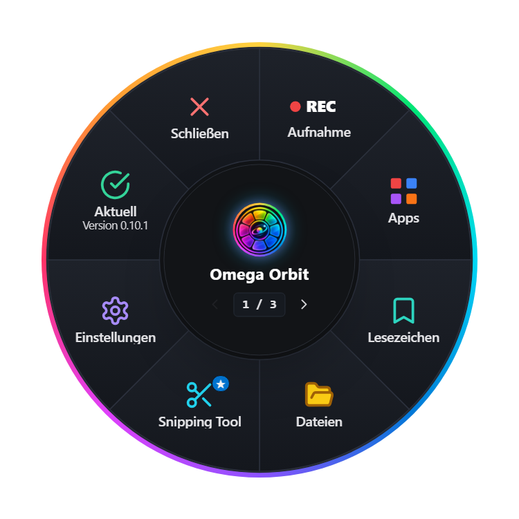
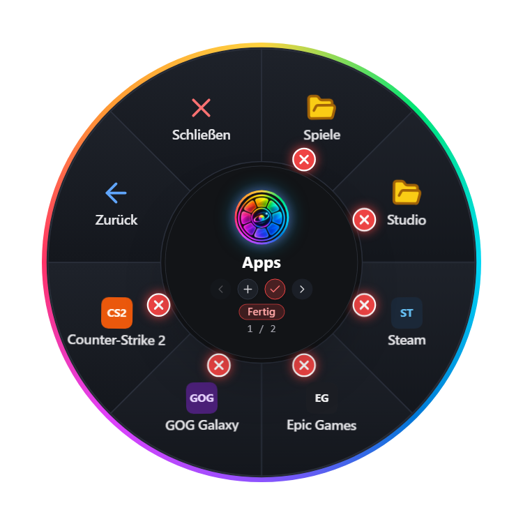
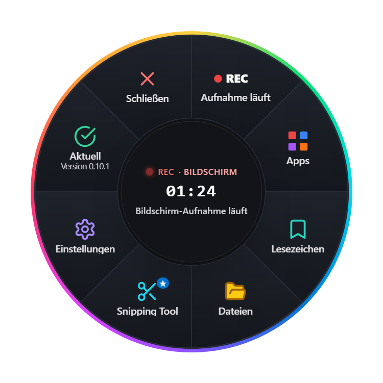
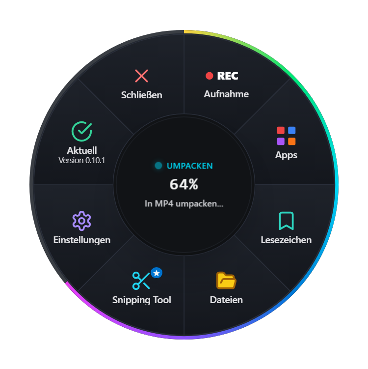
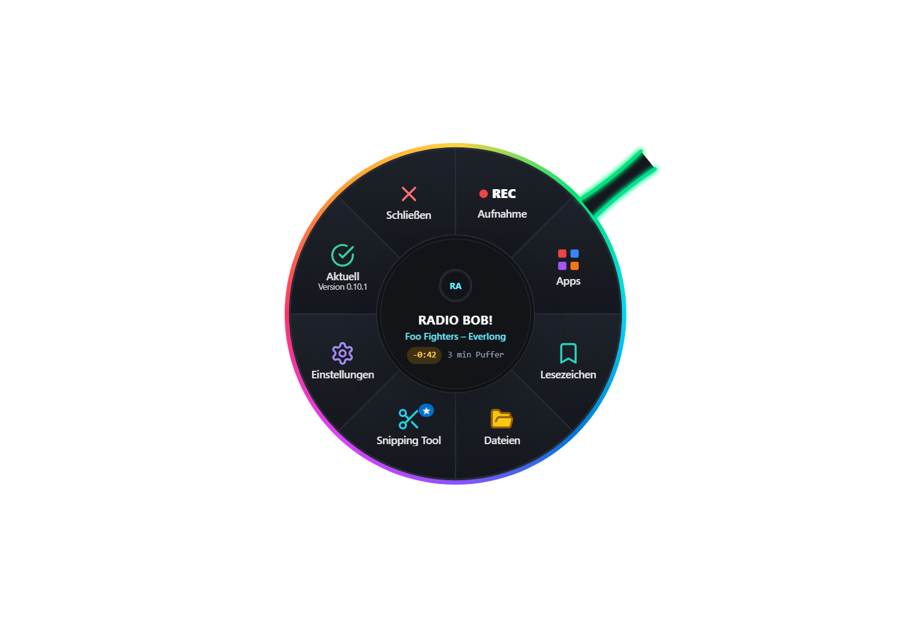
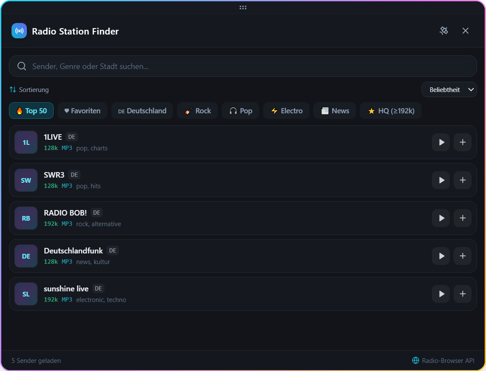
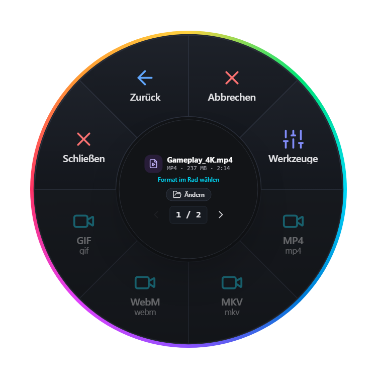
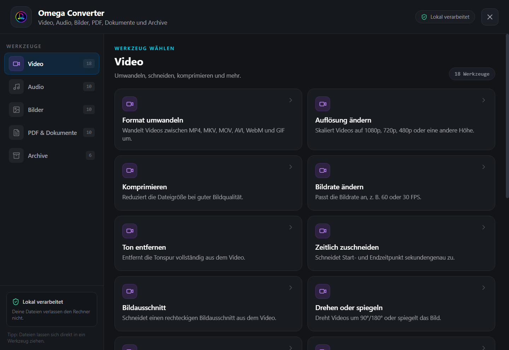
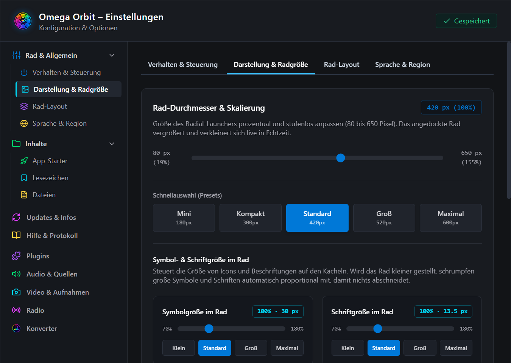
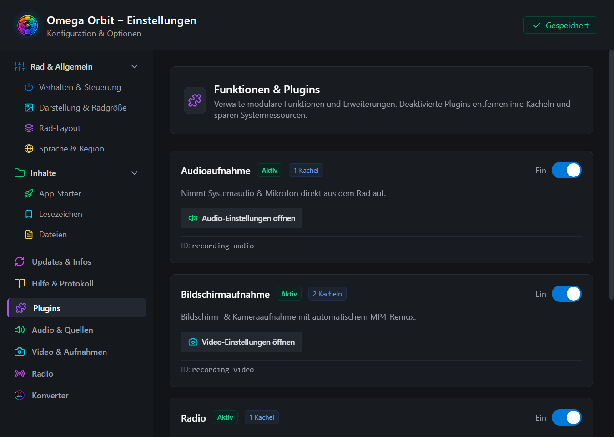

<h1 align="center">Omega Orbit</h1>

<strong><a href="https://orbit.omegaprojects.de">orbit.omegaprojects.de</a> – Ein Produkt von <a href="https://omegaprojects.de">omegaprojects.de</a></strong>

Deine Werkzeuge direkt am Mauszeiger · Your tools right at your cursor

  <a href="https://orbit.omegaprojects.de">Website</a> ·
  <a href="https://orbit.omegaprojects.de/download">Download</a> ·
  <a href="https://omegaprojects.de/projects/omega-orbit">Omega Projects</a> ·
  <a href="https://omegaprojects.de/contact">Kontakt &amp; Feedback</a> ·
  <a href="#deutsch">Deutsch</a> · <a href="#english">English</a> ·
  <a href="CHANGELOG.md">Changelog DE</a> · <a href="CHANGELOG.en.md">Changelog EN</a>

  
  

---

## ⚡ Download / Herunterladen

| System | Download & Produktseite | Status |
| --- | --- | --- |
| Windows 10 / 11 (64-Bit) | [**orbit.omegaprojects.de/download**](https://orbit.omegaprojects.de/download) · [**orbit.omegaprojects.de**](https://orbit.omegaprojects.de) | Verfügbar / Available |
| macOS · Linux | — | Geplant / Planned |

Über [**orbit.omegaprojects.de/download**](https://orbit.omegaprojects.de/download) gelangst du immer direkt zur jeweils neuesten Windows-Version. Bereits installierte Versionen lassen sich bequem über das integrierte Update-System aktualisieren.

Visit [**orbit.omegaprojects.de/download**](https://orbit.omegaprojects.de/download) to always reach the latest Windows setup. Installed versions can be updated directly via the built-in updater.

---

## 📸 Einblicke / Screenshots

| Orbit-Rad (Startansicht) · Main Wheel | Ordner & Wackelmodus · Folders & Wiggle Edit |
| :---: | :---: |
|  |  |

| Aktive Aufnahme · Live Recording | Regenbogen-Fortschritt · Rainbow Progress |
| :---: | :---: |
|  |  |

| Radio-Satellit am Rad · Docked Radio Satellite | Weltweite Sendersuche · Station Finder |
| :---: | :---: |
|  |  |

| Konverter im Rad · In-Wheel Converter | Konverter-Arbeitsbereich · Converter Workspace |
| :---: | :---: |
|  |  |

| Darstellung & Größe · Appearance & Sizing | Modulare Plugins · Modular Plugins |
| :---: | :---: |
|  |  |

---

# 🇩🇪 Deutsch

**Omega Orbit** ([orbit.omegaprojects.de](https://orbit.omegaprojects.de) – ein Produkt von [omegaprojects.de](https://omegaprojects.de)) bündelt deine wichtigsten Werkzeuge in einem konfigurierbaren Radial-Rad direkt am Mauszeiger (`Strg + Leertaste`). Starte Programme und Spiele aus eigenen Ordnern, nimm Bildschirm, Webcam und Audio synchron auf, höre und schneide Internetradio im andockbaren Satelliten-Player mit und wandle Dateien lokal im Rad oder im Konverter-Arbeitsbereich um.

## 🌟 Funktionsumfang

- **Radial-Schnellstarter mit Ordnern & Wackelmodus:** Öffne das Rad per Tastenkürzel direkt am Cursor – mit frei anpassbarer Rad-, Symbol- und Schriftgröße, mehreren Seiten sowie Ordnerverwaltung per Drag-and-drop.
- **Spiele, Apps, Lesezeichen & Dateien:** Erkennt installierte Windows- und Store-Programme sowie Spiele von Steam, Epic Games, GOG Galaxy, Ubisoft Connect und Xbox automatisch mit echten Symbolen.
- **Bildschirm-, Kamera- & Multi-Audio-Aufnahme:** Zeichne Systemton und Mikrofonquellen in WAV oder MP3 sowie Bildschirme mit bis zu 4K / 120 FPS und Hardware-Beschleunigung (NVIDIA NVENC, Intel QSV, AMD AMF) auf – inklusive frei zuschneidbarer Webcam-Masken und verlustfreiem MP4-Umpacken.
- **Internetradio-Player & Radio-Aufnahme:** Durchsuche Sender weltweit mit Direktvorschau, docke den kompakten Satelliten-Player ans Rad an (oder platziere ihn frei), spule im Timeshift zurück, sichere erkannte Songs mit einem Klick oder schneide ganze Sendungen als Original, MP3, WAV oder FLAC auf einem eigenen Audiogerät mit.
- **Lokaler Medien-Konverter:** Wandle Video-, Audio-, Bild-, PDF-/Dokument-Dateien (inklusive OCR) und Archive (ZIP, 7-Zip, RAR) komplett offline ohne Cloud-Upload um.
- **Modulares Plugin-System & geschützte Updates:** Aktiviere oder deaktiviere Audioaufnahme, Bildschirmaufnahme, Radio und Konverter einzeln in den Einstellungen. Laufende Aufnahmen und Konvertierungen werden durch Updates niemals unterbrochen.

## 🎯 Bedienung

| Aktion | Tastenkombination / Maus |
| --- | --- |
| Rad öffnen | `Strg + Leertaste` (in den Einstellungen anpassbar) oder Klick ins Windows-Tray |
| Kachel auswählen | Mit der Maus anklicken oder mit Pfeiltasten / `Tab` ansteuern und `Enter` drücken |
| Blättern | Mausrad über dem Rad drehen oder Pfeile in der Radmitte nutzen |
| Ordner & Bearbeiten | `+` legt Einträge oder Ordner an; `Bearbeiten` (oder Gedrückthalten) startet den Wackelmodus zum Sortieren |
| Zurück / Schließen | `Esc` oder Klick auf Zurück/Schließen; Verhalten im Vordergrund und beim Loslassen von `Strg` einstellbar |
| Einstellungen & Beenden | Rechtsklick auf das Orbit-Symbol im Windows-Infobereich (Tray) |

## 📜 Versionsverlauf

Alle Änderungen stehen verständlich zusammengefasst im [öffentlichen Changelog](CHANGELOG.md).

---

# 🇬🇧 English

**Omega Orbit** ([orbit.omegaprojects.de](https://orbit.omegaprojects.de) – a product by [omegaprojects.de](https://omegaprojects.de)) brings your essential desktop tools together in a customizable radial wheel right at your cursor (`Ctrl + Space`). Launch apps and games organized in custom folders, capture screen, webcam, and multi-source audio in sync, listen to and record internet radio in a dockable satellite player, and convert files locally inside the wheel or the converter workspace.

## 🌟 Key Capabilities

- **Radial Quick-Launcher with Folders & Wiggle Edit:** Summon the wheel via customizable hotkey directly at your cursor – with flexible wheel, icon, and label sizing, multiple pages, and drag-and-drop folder organization.
- **Games, Apps, Bookmarks & Files:** Automatically detects installed Windows and Store apps alongside games from Steam, Epic Games, GOG Galaxy, Ubisoft Connect, and Xbox with authentic icons.
- **Screen, Webcam & Multi-Source Audio Recording:** Record system audio and microphone inputs as WAV or MP3, plus screens up to 4K / 120 FPS with hardware acceleration (NVIDIA NVENC, Intel QSV, AMD AMF) – complete with customizable webcam masks and lossless MP4 remuxing.
- **Internet Radio Player & Recorder:** Browse stations worldwide with instant preview, dock the compact satellite player directly to the wheel (or move it freely), scrub live broadcasts with timeshift, export recognized songs in one click, or record full shows as Original stream, MP3, WAV, or FLAC on a dedicated output device.
- **Offline Media Converter:** Convert video, audio, image, PDF/document files (including OCR), and archives (ZIP, 7-Zip, RAR) 100% locally with zero cloud uploads.
- **Modular Plugins & Safe Updates:** Toggle Audio Recording, Screen Recording, Radio, and Converter individually in Settings. Active recordings and conversions are never interrupted by updates.

## 🎯 Controls

| Action | Shortcut / Mouse |
| --- | --- |
| Open the wheel | `Ctrl + Space` (customizable in settings) or click the tray icon |
| Select a tile | Click with mouse, or navigate with arrow keys / `Tab` and press `Enter` |
| Paging | Scroll mouse wheel over the launcher or click the center hub arrows |
| Folders & Edit | Use `+` to add items or folders; click `Edit` (or press and hold) for drag-and-drop wiggle mode |
| Back / Close | `Esc` or click Back / Close; always-on-top and key-release closing are configurable |
| Settings & Quit | Right-click the Orbit icon in the Windows notification area (tray) |

## 📜 Changelog

See the [public changelog](CHANGELOG.en.md) for a plain-language summary of all updates and fixes.
